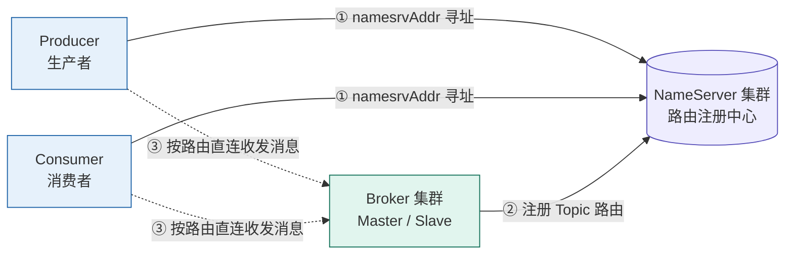

+++
date = '2026-10-15T09:54:28+08:00'
draft = false
title = 'RocketMQ 的 NameServer 介绍'
categories = ['后端技术', 'RocketMQ']
tags = ['RocketMQ', 'NameServer', '消息队列']
toc = true
+++


## 为什么需要 NameServer

没有 NameServer 时，生产者 / 消费者必须**写死 Broker 的 IP 和端口**。一旦遇到下面任何一种情况，所有客户端都得改配置、重启：

- Broker **扩容**（新增节点）；
- Broker **宕机**或**换机器**（IP 变了）；
- 主从切换、集群拓扑调整。

在分布式系统里，这种**客户端直连、地址硬编码**的方式完全不可维护。因此需要一层**路由注册中心**来解耦：客户端不必知道 Broker 在哪，只要知道**去哪查路由**即可。

## NameServer 的作用

**NameServer** 是 RocketMQ 的**轻量级路由注册中心**（类比微服务里的注册中心 / 公司内部的通讯录）；而 **`namesrvAddr`** 就是「通讯录服务器的 IP 和端口」清单。

> 类比：NameServer 像公司的内部通讯录，`namesrvAddr` 就是通讯录服务器的地址。你（客户端）不记得每个人（Broker）的号码，但只要拿到通讯录地址，就能查到该找谁。

关键特征：**NameServer 无状态、节点之间互不通信**，每个节点各自独立保存全量路由信息。

客户端与 Broker 围绕 NameServer 形成三步链路：

1. **① 寻址**：Producer / Consumer 启动时，按 `namesrvAddr` 连上 NameServer。
2. **② 注册**：Broker 启动时把自己的 Topic 路由信息（哪些 Queue 在哪些 Broker 上）注册到 NameServer。
3. **③ 直连**：客户端向 NameServer **拉取路由表**，然后**直接连 Broker** 收发消息（后续消息收发不再经过 NameServer）。



## NameServer Address

格式是 **`host:port` 用分号 `;` 分隔** 的多个节点清单：

```
192.168.1.10:9876;192.168.1.11:9876;192.168.1.12:9876
```

- 默认端口 **9876**（NameServer 专用，与 Broker 的 `10911` 等端口是两回事）。
- 通常部署 **2~3 个节点**做高可用；客户端会逐个尝试，连上一个即可。
- 节点间**互不通信、各自独立**（无状态），所以清单里写几个都行，丢一个不影响。

### 配置 NameServer Address

| 方式        | 写法                                                             | 适用场景                | 优先级 |
| --------- | -------------------------------------------------------------- | ------------------- | --- |
| 代码里设置     | Python：`producer.set_name_server_address("ip1:9876;ip2:9876")` | 单应用硬编码，最简单          | 中   |
| Docker 部署 | 镜像 `apache/rocketmq` + `./mqnamesrv`，环境变量 `NAMESRV_ADDR`，见下文                       | 容器化运行 NameServer 本身 | —   |

## Docker 部署 NameServer 和 Broker

创建 `docker-compose.yml` 文件和 `broker.conf` 文件，放在同一目录下，内容如下：

```yaml
services:
  namesrv:
    image: apache/rocketmq:5.3.0
    platform: linux/amd64          # Apple Silicon 必须；x86 机器可删掉此行
    container_name: rmqnamesrv
    ports:
      - "9876:9876"
    command: ["./mqnamesrv"]
    networks:
      - rocketmq-net
    restart: unless-stopped

  broker:
    image: apache/rocketmq:5.3.0
    platform: linux/amd64          # Apple Silicon 必须；x86 机器可删掉此行
    container_name: rmqbroker
    ports:
      - "10909:10909"   # VIP 通道端口
      - "10911:10911"   # 客户端 remoting 端口
    environment:
      - NAMESRV_ADDR=namesrv:9876
    volumes:
      - ./broker.conf:/opt/broker.conf:ro   # 见下方 broker.conf
    command: ["./mqbroker", "-n", "namesrv:9876", "-c", "/opt/broker.conf"]
    depends_on:
      - namesrv
    networks:
      - rocketmq-net
    restart: unless-stopped

networks:
  rocketmq-net:
```

```conf
brokerClusterName = DefaultCluster
brokerName = broker-a
brokerId = 0
deleteWhen = 04
fileReservedTime = 48
brokerRole = ASYNC_MASTER
flushDiskType = ASYNC_FLUSH
brokerIP1 = broker
```

> brokerClusterName：默认集群名，同一集群内所有 Broker 必须填相同名字 \
> brokerName：Broker 分组名，主从节点必须相同 brokerName \
> brokerId：节点编号，`0` = Master 主节点，大于 0 = Slave 从节点 \
> deleteWhen：每天几点执行过期 commitlog 文件清理 \
> fileReservedTime：消息文件保留时长，单位小时 \
> brokerRole：Broker 主从复制角色，`ASYNC_MASTER` = 异步主节点，`ASYNC_SLAVE` = 异步从节点，`SLAVE` = 从节点，不接收生产者写入，消费者可以拉取 \
> flushDiskType：刷盘策略，`ASYNC_FLUSH` = 异步刷盘，`SYN_FLUSH` = 同步刷盘 \
> brokerIP1：Broker 对外暴露的服务 IP，用于客户端直连


执行：

```bash
$ docker compose -f './docker-compose.yml' up -d --build
```

查看运行状态：

```bash
docker compose ps
NAME         IMAGE                   COMMAND                  SERVICE   CREATED         STATUS         PORTS
rmqbroker    apache/rocketmq:5.3.0   "./docker-entrypoint…"   broker    2 minutes ago   Up 2 minutes   0.0.0.0:10909->10909/tcp, [::]:10909->10909/tcp, 0.0.0.0:10911->10911/tcp, [::]:10911->10911/tcp
rmqnamesrv   apache/rocketmq:5.3.0   "./docker-entrypoint…"   namesrv   2 minutes ago   Up 2 minutes   0.0.0.0:9876->9876/tcp, [::]:9876->9876/tcp
```

## 创建 Topic

进入 NameServer 容器：

```bash
$ docker exec -it rmqnamesrv /bin/bash
```

执行：

```bash
$ ./mqadmin updateTopic -n namesrv:9876 -c DefaultCluster -t test_topic
create topic to 127.0.0.1:10911 success.
TopicConfig [topicName=test_topic, readQueueNums=8, writeQueueNums=8, perm=RW-, topicFilterType=SINGLE_TAG, topicSysFlag=0, order=false, attributes={}]
```

即新创建了一个 `test_topic` 的 Topic。

#### librocketmq 动态库

因为的我电脑是 M2 Silicon，安装 librocketmq 动态库比较麻烦，而且我尝试了多种方法，都没有成功。

这里介绍一种通过构建 Docker 镜像的方式，来运行 RocketMQ 相关的 python 代码。

创建 `Dockerfile` 文件，内容如下：

```dockerfile
FROM python:3.13-slim

RUN apt-get update && \
    apt-get install -y --no-install-recommends gcc g++ make libssl-dev

# 安装 RocketMQ C++ 客户端
COPY rocketmq-client-cpp-2.2.3.amd64.deb /tmp/
RUN dpkg -i /tmp/rocketmq-client-cpp-2.2.3.amd64.deb \
    && rm /tmp/rocketmq-client-cpp-2.2.3.amd64.deb \
    && ldconfig

WORKDIR /app
COPY requirements.txt .
RUN pip install -r requirements.txt

ENTRYPOINT ["python3"]
CMD []
```

相同目录下存在两个文件：

- rocketmq-client-cpp-2.2.3.amd64.deb
- requirements.txt

requirements.txt 内容如下：

```text
rocketmq-client-python
```

构建镜像，执行：

```bash
$ docker build --platform linux/amd64 -t rocketmq:1.1 .
```

构建完之后，就可以使用 `docker run --rm --platform linux/amd64 --network rocketmq_rocketmq-net -v $(pwd):/app rocketmq:1.1 main.py` 来运行代码了。


## Python 代码示例

**测试生产者 / 消费者连接是否正常**

```python
# main.py
from rocketmq.client import Producer, PushConsumer

namesrv_addr = "namesrv:9876"

producer = Producer("test_producer")
producer.set_name_server_address(namesrv_addr)

try:
    producer.start()
    print("Producer started successfully")
except Exception as e:
    print(f"Producer start failed: {e}")


consumer = PushConsumer("test_consumer")
consumer.set_name_server_address(namesrv_addr)
consumer.subscribe("test_topic", "*")

try:
    consumer.start()
    print("Consumer started successfully")
except Exception as e:
    print(f"Consumer start failed: {e}")
```

执行：

```bash
$ docker run --rm --platform linux/amd64 --network rocketmq_rocketmq-net -v $(pwd):/app rocketmq:1.1 main.py
Producer started successfully
Consumer started successfully
```

`--network rocketmq_rocketmq-net` 连接 RocketMQ 网络，这样就可以在容器中访问 NameServer 和 Broker。

`-v $(pwd):/app` 映射当前目录到容器的 `/app` 目录，这样就可以在容器中运行代码。

**消息的发送与接收**

```python
# main2.py
import sys
import time
import multiprocessing
from rocketmq.client import Producer, PushConsumer, Message, ConsumeStatus

namesrv_addr = "namesrv:9876"
topic = "test_topic"
tag = "test_tag"


def consumer_process():
    def msg_listener(msg):
        body = msg.body.decode("utf-8")
        tags = msg.tags.decode("utf-8")
        print(f"【Consumer收到消息】msgId:{msg.id}, body:{body}, tag: {tags}", flush=True)
        return ConsumeStatus.CONSUME_SUCCESS

    consumer = PushConsumer("test_consumer")
    consumer.set_name_server_address(namesrv_addr)
    consumer.subscribe(topic, msg_listener, tag)
    consumer.start()
    print("Consumer 进程已启动，等待消息", flush=True)
    try:
        while True:
            time.sleep(1)
    except KeyboardInterrupt:
        print("\nConsumer 收到中断", flush=True)
    finally:
        consumer.shutdown()
        print("Consumer shutdown", flush=True)


def producer_process(msg_count: int):
    producer = Producer("test_producer")
    producer.set_name_server_address(namesrv_addr)
    producer.start()
    print("Producer 进程已启动，开始发送", flush=True)
    for i in range(msg_count):
        msg = Message(topic)
        msg.set_tags(tag)
        msg.set_body(f"test_body_{i}".encode("utf-8"))
        producer.send_sync(msg)
        print(f"发送成功 test_body_{i}", flush=True)
        time.sleep(0.5)
    producer.shutdown()
    print("Producer 发送完毕退出", flush=True)


if __name__ == "__main__":
    multiprocessing.set_start_method("spawn", force=True)

    n = int(sys.argv[1]) if len(sys.argv) > 1 else 3

    p_consumer = multiprocessing.Process(target=consumer_process)
    p_consumer.daemon = True
    p_consumer.start()
    time.sleep(3)

    p_producer = multiprocessing.Process(target=producer_process, args=(n,))
    p_producer.start()
    p_producer.join()

    try:
        while True:
            time.sleep(1)
    except KeyboardInterrupt:
        print("\n主进程收到Ctrl+C，准备退出", flush=True)
    finally:
        print("程序退出", flush=True)
```

```bash
$ docker run --rm --platform linux/amd64 --network rocketmq_rocketmq-net -v $(pwd):/app rocketmq:1.1 main2.py 3
Consumer 进程已启动，等待消息
Producer 进程已启动，开始发送
发送成功 test_body_0
【Consumer收到消息】msgId:AC150005003464A270AC4A1EF93B0000, body:test_body_0, tag: test_tag
发送成功 test_body_1
【Consumer收到消息】msgId:AC150005003464A270AC4A1EFB3D0001, body:test_body_1, tag: test_tag
发送成功 test_body_2
【Consumer收到消息】msgId:AC150005003464A270AC4A1EFD360002, body:test_body_2, tag: test_tag
Producer 发送完毕退出
```

* 采用多进程的方式：
    * Consumer 进程负责接收消息
    * Producer 进程负责发送消息
* 在各自进程中分别创建 `PushConsumer` 和 `Producer` 实例
    * Consumer 进程订阅主题，设置消息监听函数，保持进程常驻
    * Producer 进程发送消息
